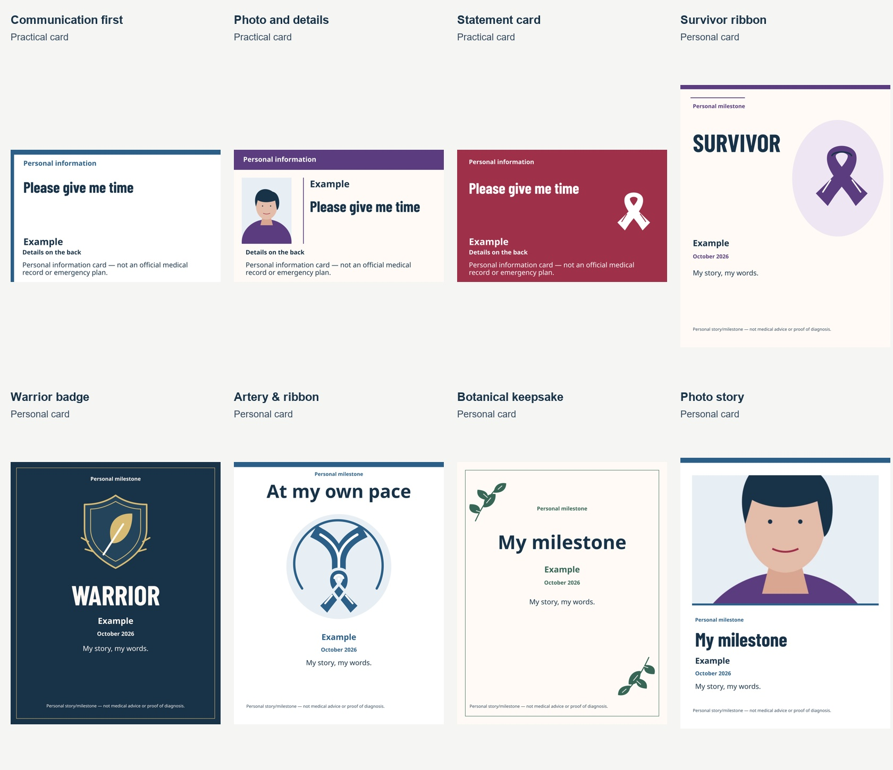
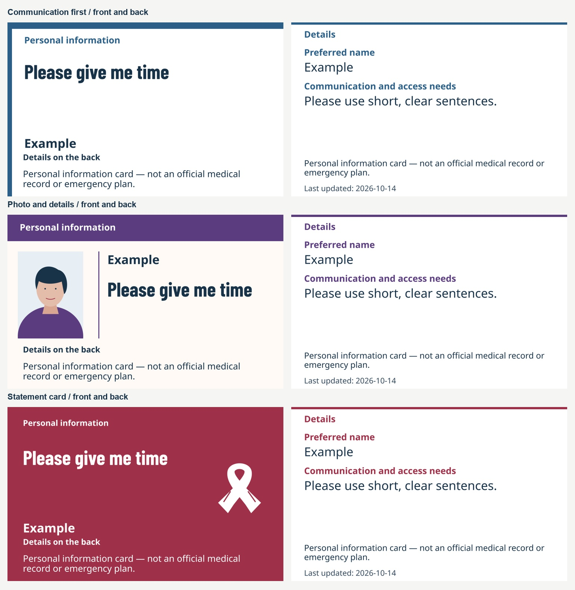
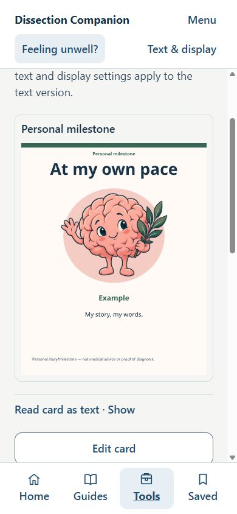

# Designed card collection

Implemented and checked on 14 October 2026 in the existing Expo project. This is an engineering record for the English website, not clinical approval, patient feedback or accessibility certification. The eight full examples were rendered and inspected before their gallery was integrated.

## Collection and controls

| Practical front/back wallet cards | Personal milestone/expression cards |
|---|---|
| Communication first: a large statement and restrained blue band | Survivor ribbon: oversized lettering and a prominent original ribbon |
| Photo and details: optional portrait, name and statement, plum band | Warrior badge: shield/leaf emblem, condensed lettering, navy/gold |
| Statement card: cranberry statement front, optional ribbon | Friendly brain: substantial original illustration, coral/sage/warm paper |
| White reverse and labelled continuation panels for each | Botanical keepsake: leafy framing and balanced typography |
| Larger-text A4 and text alternatives | Photo story: optional image above its caption panel |

Each template has three curated colour combinations. Selecting a template changes appearance only. Words, dates and retained photos survive switching. Starter wording is a separate action. Appearance Undo and a plain-layout option preserve the person's words. The phone gallery uses miniature compositions beside clear names; enlarged text stacks the layout. Preview and exports share the same measured scene. Milestone outputs use direct wording without form-like Name/Message headings.

## Implementation boundaries

- `templates.mjs` allowlists templates, palettes and compatible illustrations. Previous v1 keys, version and appearance remain valid until the person chooses a new design.
- `layout.mjs` measures text, photo crops and continuation panels. `scene-svg.mjs` supplies preview, PNG and white-paper print; `scene-pdf.mjs` uses the same coordinates, fonts and pagination. Wallet panels are 85.6 × 54 mm. Milestone PNGs start at 1080 × 1350 and grow for long text.
- Barlow Condensed Bold is locally bundled with its SIL Open Font License. Noto Sans is used for details and display-font fallback. Latin/Cyrillic examples were checked. Unsupported glyphs give a text alternative; universal script/emoji support is not claimed.
- Public artwork is original, with the AI-assisted brain's provenance and prompt in [the asset notes](../public/card-art/README.md). Commercial examples were not copied. Photo examples are synthetic illustrations.
- Personal photos are optional. JPEG/PNG/WebP input is decoded and re-encoded locally. Source orientation is applied, source metadata/filename are discarded, the longest edge is capped at 1280px, and the stored format is JPEG. Newly chosen photos remain in memory until explicit Save.
- Saved Blobs use IndexedDB, with opaque IDs in the original card JSON and separate personal/milestone owners. Save uses compensating rollback across the two storage mechanisms. Save/deletion/clear failures do not report success; incomplete rollback is reported explicitly. Quotas, eviction and backups remain browser/device limitations.
- Clear-all drains pending writes, clears all six original keys and the additional photo resource, and resets active card memory. Late photo processing cannot restore a cleared draft. A failed global clear marks the saved state uncertain while preserving the draft.
- Private wording/photos never enter design-tool exports. The source-only workbench fingerprints models, storage, layouts and licences and exports only public tokens/resource descriptors.

## Validation evidence

Tests used disposable synthetic fixtures on `http://127.0.0.1:4183`. The user's normal preview and saved information were preserved. This profile was cleared after testing.

| Check | Evidence and result |
|---|---|
| Eight distinct arrangements and palette contrast | Unit tests compare structural compositions using identical words. 96 card colour pairs meet 4.5:1; the existing four-theme interface checks also pass. This does not certify the whole app. |
| Output inspection | [PDF raster comparison](designed-cards-proof/pdf-render-comparison.jpg), [no-photo/no-art compositions](designed-cards-proof/without-photo-or-art.jpg), full PNGs and front/back examples inspected. |
| Practical creator | Blank optional fields, selected communication statements, edit/preview/return, explicit save, reload with photo, template change and Undo, keyboard crop buttons, invalid replacement, hidden event date, wallet PDF and text checked in browser. |
| Long practical details | Browser wallet export produced 10 fixed-size panels. PDF and text contained matching synthetic medicine/allergy entries; hidden event date absent. Detail text stays fixed at 38 design units rather than shrinking. |
| Photo processing | A sideways-pixel JPEG with orientation/artist/description metadata exported upright at 960 × 1280, with zero EXIF entries. WebP selection/save/reload succeeded. Transparent PNG input became an opaque JPEG at 1280 × 1170, with white corners and no EXIF. Invalid JPEG replacement kept the previous photo. Size/type guards have unit coverage. |
| Milestone creator | Unsaved selected photo/name disappeared on reload; explicit save restored a photo story. Words survived template change, photo removal and Undo. Actual PNG/PDF downloads checked. Survivor/Warrior remain optional. The explicit plain layout uses the same filtered scene and direct-word text output. |
| Legacy compatibility | A saved legacy Ink heading card was restored, the design gallery opened and Back to my words used. Its original title and selected Ink appearance stayed unchanged. Selecting the new plain layout is an explicit appearance change. |
| Deletion and recovery | Cancel deletion kept the preview. Confirmed milestone deletion left the practical card saved. Clear-all removed both cards and retained blank state after reload. Adapter tests cover interrupted writes, rollback, wrong-owner photos, resource-clear failure and retry. |
| Reflow/display | 390px, 320px, 1440px desktop and 844 × 320 landscape inspected. Doubled app text, spacing, four themes and reduced-motion preference checked. No horizontal document overflow in observed states. At doubled text in short landscape the active reading area remains scrollable (108px height). Readable words precede artwork with large text/high contrast. A black-on-dark unstyled-text fault was reproduced and fixed in the shared text wrapper; [actual rendered foreground/background pairs](designed-cards-proof/rendered-text-themes.json) were verified in all four themes. |
| Keyboard | Enter operated buttons, radio navigation/crop controls tested, and Menu Escape restored focus with a visible outline. This is targeted keyboard coverage, not a full assistive-technology assessment. |
| Privacy trace | [Untruncated synthetic trace](designed-cards-proof/privacy-trace.json): no name/contact/medicine/EXIF/filename markers in captured requests, URL or logs. Blob URLs were local rendering references; the only HTTP request in that warm-cache trace was a same-origin code chunk. An earlier cold-cache trace loaded only public same-origin fonts/art/code. |
| Build checks | 99 unit tests, source/content/review/native-config validators, TypeScript, design validation, static web export and 36 exported route/asset checks passed. Existing clinical and market release blocks remain in place. |

## Named limitations

NVDA, VoiceOver, TalkBack, actual browser 200% zoom, native photo/export implementation, physical wallet printing/duplex alignment and real patient/carer usability remain untested. App text enlargement is not browser zoom. Print invocation and white-paper layout/pagination were checked; operating-system print completion/cancellation was not automated. The browser file-picker interface did not support cancelling a selection, so cancellation remains a manual check; code only begins processing after a file is returned. Real IndexedDB save/reload and delete/clear UI journeys passed, but direct database inventory was unavailable in the browser tooling. Storage-failure injection used isolated adapters, not a real exhausted browser quota.

These designs make no claim to prevent migraine or PTSD reactions. Medical/emergency wording was retained; no clinical approval or new medical advice was added. Native parity and any public clinical release still require their separate reviews.
