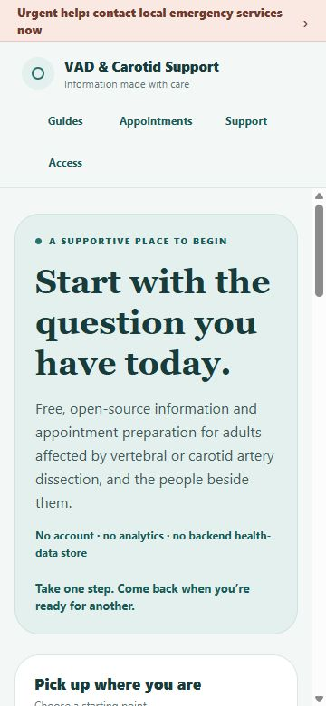
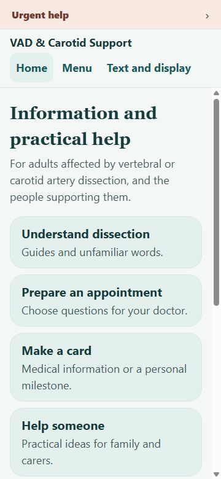
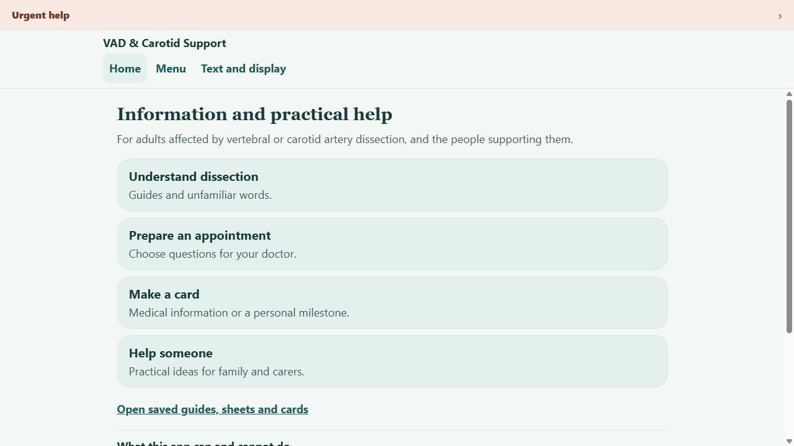
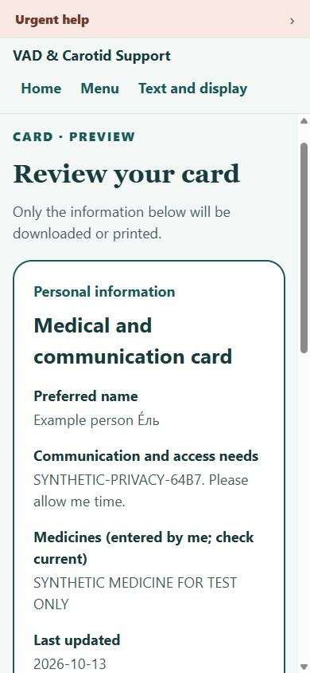
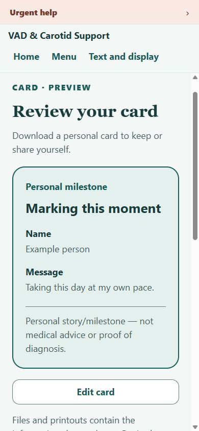
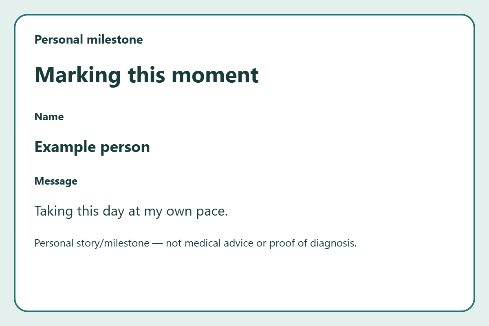
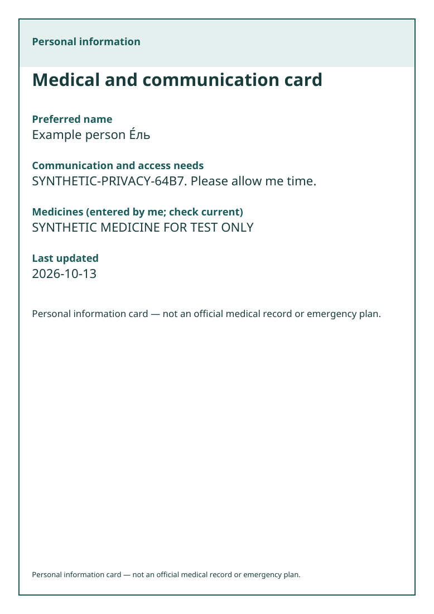
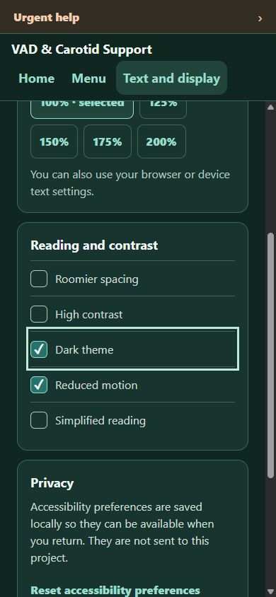
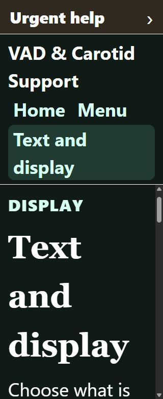

# Fewer choices, useful cards, easier return

Implementation and engineering checks: 13 October 2026. Scope: the English static website and shared Expo components. Clinical approval, participant usability review and assistive-technology review remain separate.

The subsequent [patient-menu walkthrough and repairs](PATIENT_MENU_REPAIRS_2026-10-13.md) address enlarged-menu scrolling, lost sheet drafts, reading-mode consistency, session resume and inner-page reading load. It includes separate before/after evidence and the limits of these engineering checks.

## Problem and evidence

The previous home repeated tasks across 19 content links. On a phone, the introduction occupied most of the initial screen. Cards exported only text, the hidden-date choice did not remove the date, printing included the form, clean card URLs failed in the preview server, and a restored card could report that nothing was saved. An invisible skip link overlapped the mobile Home control.

These findings came from browser interaction and source inspection. They do not establish how a patient will experience the site.

## Standards and source comparisons

The accessibility target is [WCAG 2.2 AA](https://www.w3.org/TR/WCAG22/), including reflow, contrast, keyboard access, visible focus, control names and status messages. This is a target, not a conformance declaration. [W3C cognitive accessibility guidance](https://www.w3.org/TR/coga-usable/) adds useful guidance about reducing memory demands, distractions and unnecessary content; it supplements WCAG rather than replacing testing.

| Primary source | Pattern considered | Application here | Limit |
|---|---|---|---|
| [NHS England patient-website guide, July 2023](https://www.england.nhs.uk/wp-content/uploads/2022/09/PRN00651-creating-a-highly-usable-and-accessible-gp-website-for-patients-v3.pdf), sections 1.1 and 3.1–3.6 | Prioritise patient tasks, reduce text, use clear labels and a usable main menu | Four home actions and one labelled inline menu | GP-service research does not validate this dissection-support website; no NHS branding or endorsement is implied |
| [GOV.UK question pages](https://design-system.service.gov.uk/patterns/question-pages/) | Clear questions, predictable progression and easy correction | Short optional card form, separate preview, visible Edit control | Forms are shorter here; an extra screen per optional field would add navigation effort |
| [Australian Aphasia Association printable ID card](https://aphasia.org.au/get-a-free-printable-aphasia-id-card/) | Practical communication information that can be carried or printed | Optional communication statements and user-authored details | This app's card is not that organisation's card or a verified medical record |
| [W3C motion guidance](https://www.w3.org/WAI/WCAG22/Understanding/animation-from-interactions.html) | User control over nonessential interaction motion | No decorative animation, automatic smooth scrolling, autoplay or flashing | These choices cannot guarantee prevention of migraine or trauma reactions |

Teal surfaces and rounded panels retain the visual direction the project owner selected. Graphic medical imagery, automatic anniversary reminders and forced “survivor” wording are absent. This is a design response to stated preferences, not evidence of a clinical benefit.

## Implemented experience

The home shows **Understand dissection**, **Prepare an appointment**, **Make a card** and **Help someone**, followed by one saved-items link and a short explanation of the app's limits. It asks neither a diagnosis-pathway question nor a patient/carer classification. Existing guide and stroke-related URLs remain available.

The header stays consistent: **Home**, **Menu**, **Text and display**. Menu opens in the page, exposes named destinations and closes with Escape, returning focus to its button. Urgent help remains in the shell on every route; emergency instructions stay on its destination. The skip link is offscreen until keyboard focus and focuses the active route's main region.

Shared components apply readable text, line spacing, 48px minimum control heights and the selected theme throughout the interface. Display preferences remain local. Larger text changes text sizes instead of zooming the entire document. No countdown or review timer appears in the product.

## Card repair

Both tools use a short form followed by a separate review view. Optional personal-card details sit in labelled disclosures; selectable communication statements reduce typing. The anniversary card uses the person's chosen title, message and date precision, with optional “survivor” wording and no elapsed-time calculation.

A single filtered presentation feeds the visual preview, PDF, PNG where offered, standalone print document and text alternative. No date removes the entered event/milestone date from every output; the practical card's generated last-updated date remains visible. Medicines and allergies retain their user-entry/currentness label. Both safety labels remain unchanged.

The practical card downloads a designed PDF. The milestone card downloads PNG and PDF. Text remains available on both. PDF overflow creates additional pages at readable sizes, with the safety label on each page. PNG height expands for long content. Printing opens only the escaped card document, with no form controls or app instructions.

Version 1 records and the existing separate storage keys are preserved. Unsaved edits stay in app memory through navigation and form/preview changes; reload or closing loses them. Save is explicit. Restored, unsaved, saved, unreadable and failed states use different messages. Start blank leaves the saved copy intact until Save or Delete. Delete has a confirmation and Cancel; clear-all removes all six app keys and resets active sheet/card state. Exported copies remain outside deletion control.

PDF uses local, openly licensed Noto Sans fonts. Some scripts and emoji are outside that font's coverage; unsupported text produces a clear fallback to Print or Text rather than silent missing glyphs. PDF files are not tagged PDF/UA documents; the semantic HTML preview and text download remain the accessible alternatives. Native print/share adapters are implemented but not device-verified.

## Verification record

Tests used invented data on a separate localhost origin (port 4174). Existing user data on port 4173 was not edited or deleted. Screenshots contain only the interface and invented card data.

| Check | Evidence and observed result | Limit |
|---|---|---|
| Locked install and project gates | `npm ci`, TypeScript, 34 Node tests, content/review/native configuration validators, static export and 32-artifact validator | CI is engineering evidence, not clinical approval |
| Home and menu | Four home actions fit at 360 × 780; menu opens, Escape closes and restores focus; keyboard Enter on the skip link focuses the active main region | No participant completion-time claim |
| Short form → preview → edit | Actual browser flow; focus moves to the current card stage; optional values appear in preview | NVDA announcement still needs testing |
| Saved and unsaved return | Explicit synthetic save followed by reload restored the saved card; an unsaved edit survived in-app return | Does not imply protection from reload, shared profiles or backups |
| Output correctness | Actual PDF/PNG downloads inspected; Latin/Cyrillic characters preserved; hidden event date absent; unit tests cover long fields, date kinds and malformed storage | Unsupported PDF glyphs require the documented fallback |
| Print | Actual Print card opened a standalone iframe containing the card, safety label and no controls; the temporary frame was removed after the print flow | Physical printing and manual native print-dialog cancellation were not verified |
| Delete and clear-all | Browser confirmation focuses Cancel and cancellation returns focus to Delete; model tests cover per-card deletion, all keys, failures and notifying open tools after success | Browser permanent-delete confirmation was not executed against the user's saved data |
| Privacy | Captured requests after a synthetic edit/export contained only the PDF chunk and two same-origin font files; no synthetic value in request URLs/headers/bodies, console logs or page URL; capture was not truncated | This is one exercised flow, not a guarantee against browser software or future hosting/SDK changes |
| Mobile, enlarged text and themes | 320–390px layouts, 200% app text, dark/high contrast and reduced motion checked in the actual build; all four new routes had no overflowing controls at 320px/200%; checkboxes accept Space and date radios accept arrow keys | Manual 200% browser zoom and screen-reader sessions remain separate checks |

## Follow-up without collecting health information

Use the [voluntary synthetic-task protocol](USABILITY_REVIEW.md) to evaluate memory, attention, vision and communication needs. Observe whether someone can find one useful action within roughly 60 seconds without displaying a timer. Record task, friction, change and follow-up only; do not collect health histories or identifiable stories.

NVDA, manual browser zoom and wider browser/assistive-technology coverage are still required before claiming accessibility conformance. VoiceOver, TalkBack and native exports need separate device checks before native release. Clinical and patient/carer guide metadata remain pending; this redesign approves no medical wording or translated content.

For local preview, run `npm run build:web` then `npm run preview:web` and open `http://localhost:4173/`. The preview server resolves exported clean routes, including direct card URLs and reloads, and returns a real 404 for unknown routes. Production hosting must provide equivalent static-route resolution and verified response headers.
