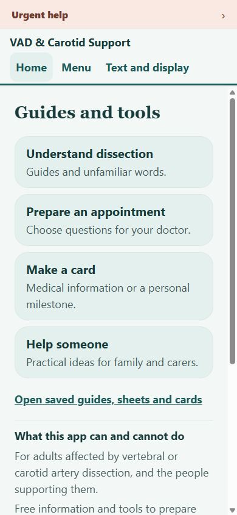
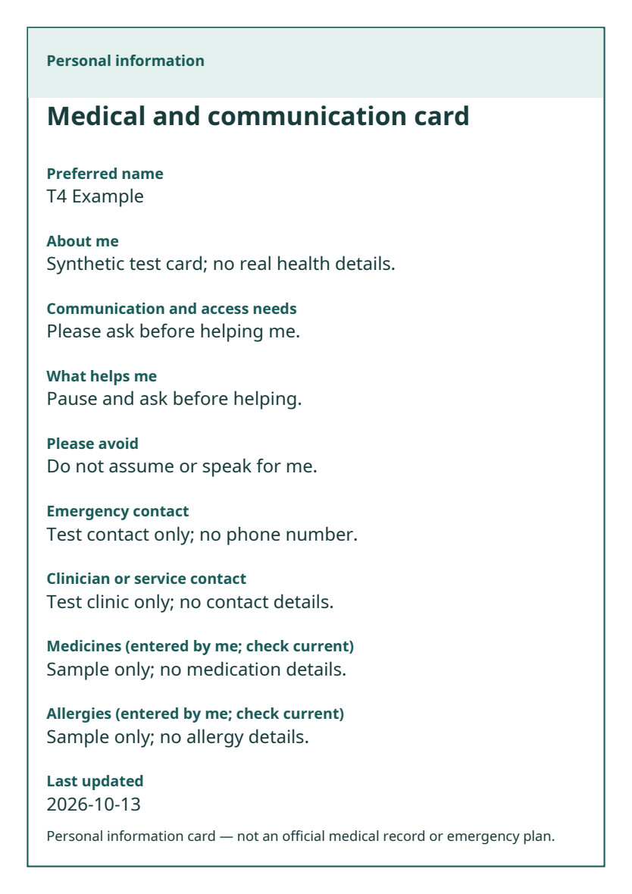

# Five simulated patient/carer audits and repairs

The subsequent [fresh/returning follow-up audit](RETURNING_USER_AUDIT.md) records a new frozen build, five evidence assessments and focused repairs. This report's original ratings and evidence remain unchanged.

13 October 2026. Target: the English Expo static website. These are five independent AI interface inspections, not patient feedback, disability simulation, clinical approval or accessibility certification.

Subsequent verification and code hardening of the eight repairs is recorded in [repair completion](REPAIR_COMPLETION.md), including the overlapping-clear regression and extracted speech lifecycle. Original reports, scores and hashes remain unchanged.

## Method and provenance

Five fresh `gpt-6-luna` agents received distinct scenarios and the same [protocol](five-tester-audit/protocol.md), with no conversation, previous ratings, source code or other testers' reports. They first explored Home, then used the shared checklist. Browser operation was serialized. The baseline was frozen at `72688788cb926af39b9813c38ac830301a0eaeda`; [baseline/origin records](five-tester-audit/origin-proof.json) establish that the five separate test origins served the same export. Only disposable invented values were entered. The user's `localhost:4173` storage was not opened, changed or cleared.

All five original reports were locked before application edits. [Report hashes](five-tester-audit/report-locks.json) preserve that boundary. Corrections and retests are separate files, not rewritten reports. T5 used an authorized new Brave tab because its agent could not access the in-app browser; repeated browser connection failures curtailed its baseline inspection. That is a coverage limitation, not evidence of a broken app. Browser recovery attempts and other interventions are recorded in individual reports.

The primary agent inspected captures and actual downloaded files before triage. T2's unstable early guide screenshots were rejected; its later `*-stable.png` captures are the accepted evidence. AI completion times are not evidence that a patient can finish in 60 seconds.

## Five individual verdicts

Each dimension uses 0 = blocked/unreliable, 1 = usable with friction or material uncertainty, 2 = successful in the observed scope. A confirmed critical technical failure would cap the affected tester at 4/10. No tester observed such a failure. Scores are the locked baseline assessments, not post-repair scores or conformance ratings.

| Tester | Navigation | Reading/access | Practical usefulness | Data/output trust | Interruption | Total | Verdict and first improvement |
|---|---:|---:|---:|---:|---:|---:|---|
| [T1: newly diagnosed, without stroke](five-tester-audit/T1/report.md) | 2 | 2 | 2 | 2 | 1 | 9/10 | Useful definitions and appointment questions; add a visible cancellation opportunity when deleting saved guides. |
| [T2: memory and attention concerns](five-tester-audit/T2/report.md) | 1 | 2 | 2 | 2 | 1 | 8/10 | Useful sheets and predictable controls; improve interruption/deletion clarity and recovery from a missing page. |
| [T3: low vision and limited hand movement](five-tester-audit/T3/report.md) | 2 | 1 | 2 | 2 | 1 | 8/10 | Keyboard and enlarged controls were useful; stop Home's heading breaking inside a word at doubled text. |
| [T4: busy family carer](five-tester-audit/T4/report.md) | 2 | 1 | 2 | 1 | 1 | 7/10 | Practical tools respect optional disclosure; avoid a medical PDF's date-only second page and clarify dates. |
| [T5: fatigue and light sensitivity](five-tester-audit/T5/report.md) | 1 | 1 | 2 | 1 | 2 | 7/10* | Recovery information and question preparation were useful; make unavailable-page recovery and speech feedback explicit. |

T1 deducted for observed guide deletion without an inspectable cancellation step. T2 deducted for a missing-page dead end, an apparent reading restart and deletion ambiguity. T3 deducted for heading readability and deletion ambiguity. T4 deducted for narrow-screen density, PDF pagination/date interpretation, and reload/confirmation uncertainty. T5 deducted for the missing-page dead end, speech-state ambiguity and unverified outputs. **T5's score applies only to its observed scope; cards, support-sheet interactions, display changes and keyboard/responsive checks were incomplete.** A high score does not turn an untested area into a pass.

The exact fields, dates and privacy observation windows are in [T1's coverage addendum](five-tester-audit/T1/coverage-details.json), [T2's coverage addendum](five-tester-audit/T2/coverage-details.json), [T3's task ledger](five-tester-audit/T3/coverage.json), and the T4/T5 structured reports. [T1 errata](five-tester-audit/T1/errata.md) and [T2 errata](five-tester-audit/T2/errata.md) take precedence over broad coverage wording. For example, T2's original “pass” sometimes means “exercised”, despite a recorded barrier.

## Baseline route/task coverage

P = observed successful operation; L = partial/scoped evidence; F = observed barrier; U = not tested. This is deliberately more conservative than some original grouped “pass” rows. P for a route means it loaded and was inspected, not that every possible interaction passed. Each individual ledger contains steps and evidence filenames.

| Route or task | T1 | T2 | T3 | T4 | T5 |
|---|:---:|:---:|:---:|:---:|:---:|
| Home/header/footer and all nine Menu destinations | P | P | P | P | P |
| `/learn`, guide search and empty results | P | P | P | P | P |
| `/appointments` entry and practical action | P | P | P | P | P |
| `/cards` chooser | L | P | P | P | P |
| `/supporting-someone` | P | P | P | P | P |
| `/support-preferences` entry | P | P | P | P | P |
| `/glossary`, matching and no-match searches | P | P | P | P | P |
| `/resources` (in-app records; external services not joined) | P | P | P | P | P |
| `/saved` and `/saved-guides` | P | L | P | P | L |
| `/about` and privacy explanation | P | P | P | P | P |
| `/accessibility` controls | P | P | P | P | U |
| `/urgent-help` and persistent shell link | P | P | P | P | P |
| Direct routes, reload, Back/Forward | P | P | P | P | P |
| Legacy `/with-stroke`, `/without-stroke` | P | P | P | P | P |
| Unavailable page: message / in-app recovery | L | F | L | L | F |
| Understanding dissection: beginning/end/review/sources | L | P | P | P | P |
| Tests and unfamiliar terms: beginning/end/review/sources | L | P | P | P | P |
| Without diagnosed stroke: beginning/end/review/sources | L | P | P | P | P |
| With stroke: beginning/end/review/sources | L | P | P | P | P |
| Recovery and quality of life: beginning/end/review/sources | L | P | P | P | P |
| Supporting someone guide: beginning/end/review/sources | L | P | P | P | P |
| Follow-up questions guide: beginning/end/review/sources | L | P | P | P | P |
| One-section / simplified reading controls | P | P | P | P | L |
| Manual speech UI / audible playback | L | L | L | L | F/U |
| Guide save/reopen; interrupted in-app return | L | F* | P | P | P |
| Sheets: select/remove, note, preview | P | P | P | P | L |
| Sheets: unsaved route leave/return | U | U | L | P | L |
| Sheets: explicit save/reload | P | P | L | P | L |
| Sheets: actual text export | P | P | P | P | U |
| Sheets: delete cancellation and confirmed removal | L | L | L | L | U |
| Cards: blank defaults, select/edit/preview/return | L | L | P | P | U |
| Cards: unsaved route leave/return | U | U | L | L | U |
| Cards: explicit save/reload, separate contents | P | P | P | P | U |
| Cards: no-event-date / other date granularities | L | L | L | L | U |
| Cards: actual PDF/text; milestone PNG | P | P | P | P | U |
| Cards: delete Cancel/Confirm | P | U | P | L | U |
| Print content / OS print cancellation | L/U | U | L/U | U | U |
| Display scale, spacing, themes, contrast, motion | P | P | P | P | U |
| Desktop, 390px, 320px, short landscape | P | P | P | P | U |
| Doubled app text / keyboard navigation | P | L | F/P | P | U |
| Generic saved labels; explicit export boundaries | P | P | P | P | L |
| Marker checks: URL/request/log observation | L | L | L | L | L |
| Clear-all on disposable origin | U | U | P | U | U |
| Actual browser zoom / NVDA / native devices | U | U | U | U | U |

\* T2's interruption mechanism was not retained. Primary replay through actual in-app links resumed Section 2 correctly on the frozen baseline; a reload/direct navigation starts a new session by design. The report remains intact, but an in-app reset fault was **not reproduced**. Baseline primary screenshots/text are in [root evidence](five-tester-audit/root).

## Confirmed findings, disagreement and accepted repairs

| Issue | Evidence and reproducibility | Classification | Repair |
|---|---|---|---|
| Home heading breaks “Information” inside the word at 200%/320–390px | T3; reproduced by primary on frozen baseline. T4 disliked header density but did not report clipping. | Reading barrier; density preference | Shorter “Guides and tools” heading; audience explanation below the four actions. Compact visible branding at large text/narrow or short viewports, retaining full accessible names. |
| Missing-page response has no Home or urgent-help route | T2/T5; primary reproduced plain 404. Other testers exercised the route but did not flag recovery. | Confirmed navigation fault | Exported app 404 page with shell, Home and urgent help; real HTTP 404 retained. Missing assets still return plain 404 rather than HTML. |
| Deletion has no reliably inspectable Cancel step | T1 saved guides, T2 support sheet, T3 appointment sheet; T4 confirmation partly uninspectable. Source contained native `confirm`/`Alert`, so “no confirmation existed” is not established. | Interaction uncertainty / usability barrier | In-page Cancel/Confirm on sheets, saved guides and clear-all; Cancel receives focus, Escape cancels and focus returns. Clear-saved wording describes removal of the current draft too. |
| Medical PDF spills only update date to page two | T4 actual PDF and rendered pages; primary inspected both. | Confirmed output/pagination fault | Reserve measured label/first-value space rather than a large arbitrary margin. Short fixture fits one page; long content still paginates at readable font sizes. |
| Same PDF disclaimer repeats in body and footer | T1; T4 did not object to repetition. | Preference | Keep one legible safety footer on each PDF page. Safety label/content is not medically changed. |
| No event date might be confused with Last updated | T4; outputs correctly omitted event date. | Preference, not a privacy leak | Explain that choosing no event date still leaves the separately labelled update timestamp. No date models/formats changed. |
| Read-aloud has unclear feedback in one browser | T5; T1–T4 observed start/stop state. Primary source inspection found an error message at the bottom of a long page. | Browser-dependent barrier | Move dedicated start/stop/finished/error status beside the speech button; guard stale callbacks. Audible output is not claimed. |
| Pending asynchronous card save can re-create cleared data | Primary forced asynchronous storage adapter, not observed by a tester in the web UI | Confirmed adapter timing fault; native timing risk | Serialize card writes, pause/drain before global clear, resume after clear/failure. Failed clearing no longer leaves writes paused. No keys or schema changed. |

The asynchronous fault was demonstrated with a controlled delayed adapter, then covered by save/delete/clear regression tests. It is not presented as a reproduced browser leak or a tester's critical failure. The reading-place suspicion and accessibility-reset-key suspicion were not reproduced and did not receive unnecessary storage changes. Unsaved drafts remain in memory during in-app navigation; closing/reloading can discard unsaved work. Explicit saving is still required.

## Repair verification

Repaired export: `entry-43829916d0b8ade49d91424899eebfb3.js`; PDF chunk `pdf-204b9aff49de1a34fcb27c4e5a187811.js`. The [primary retest ledger](five-tester-audit/root/retest-checks.json) records 21 scoped browser checks, evidence and limits. The primary performed the repaired browser journeys on a sixth, isolated origin, `localhost:52073`.

T3's attempted repaired-origin browser session could not connect. To avoid repeated broken browser sessions, affected tasks were returned to all original testers as **primary-actuated evidence reviews**. Each tester independently inspected that evidence and wrote an addendum. These are not five independent repaired-build browser runs, and they do not retroactively complete T5's baseline gaps.

| Original tester | Repair retest result | Evidence and limits |
|---|---|---|
| [T1](five-tester-audit/T1/retest.md) | Saved-guide Cancel/Confirm/reload supported; duplicate disclaimer removed from both supplied PDFs | Actual personal and milestone PDF inspection plus primary snapshots; no new T1 browser interaction |
| [T2](five-tester-audit/T2/retest.md) | Support and appointment cancellation/removal supported; in-app guide return retains Section 2; missing-page Home shown | Added support Confirm/reload evidence; original reading-interruption method remains unknown |
| [T3](five-tester-audit/T3/retest.md) | Supplied captures support heading, theme, focus, menu, deletion and missing-page repairs | Its own repaired-browser tasks remain not tested. Primary's sequential keyboard trace separately reaches all nine menu items at 200%/320px and returns focus on Escape |
| [T4](five-tester-audit/T4/retest.md) | Actual short-fixture medical PDF is one page with every field and correct safety label; Home title is in view at 320px | Artifact/capture review; native print and its own cancellation outcome unverified |
| [T5](five-tester-audit/T5/retest.md) | Missing-page recovery and speech feedback supported; cards, display, generic saved labels and clear-all evidence reviewed | Primary operation only; audio, OS print, true zoom and raw browser key inspection remain untested |

Primary replay separately passed sheet/card cancellation and confirmed deletion through reload, unsaved support/card in-app return, saved cards and preview-only downloads, guide return, all menu links, missing-page Home/Back/Forward, and clear-all. Five populated tool categories survived Cancel/reload, then were empty after Confirm/reload; display settings returned to defaults. `reducedMotion: true` is the authored default, so its checked state after clearing is expected. The raw six-key deletion/drain guarantee is adapter-test evidence; the browser's read-only evaluator did not expose `localStorage`.

The actual medical PDF, text and preview agree for the T4 short fixture. Actual milestone PNG/text preserve the tested Lithuanian, Ukrainian and Chinese text without the hidden date or medical-card fields. The bundled PDF font cannot display the tested Chinese characters: the UI correctly reports this and offers print/text alternatives. A separately previewed supported-character variant produced the milestone PDF; the different variants are clearly identified in the ledger. Long-content pagination is covered by actual PDF generation in unit tests. PDFs remain untagged; HTML/text alternatives remain available.

- Locked dependency installation passed with the unchanged lockfile.
- TypeScript passed. All 55 unit tests passed, including actual short/long PDF generation, asynchronous card clearing and HTTP 404 recovery.
- Content, review-record and native-configuration checks passed. Seven sourced guides remain drafts; 249 jurisdictions remain blocked rather than described as legally cleared.
- Static web export produced 27 routes; exported-route validation passed for 32 required artifacts including the accessible 404 page.
- The current dependency install still reports 18 high-severity package-node advisories, tracked in [dependency security](DEPENDENCY_SECURITY.md). This audit does not clear those upstream findings.

All five original Markdown/JSON report hashes were checked again after retests and remained unchanged. Git attributes preserve the audit folder's raw bytes so line-ending conversion cannot invalidate those hashes. Raw captured whitespace and Markdown hard breaks are retained; source/document edits pass the scoped whitespace check. No clinical guide text, source approvals, languages, storage keys/schema, dependency lockfile or licence changed in this repair.

## Remaining limits and release boundaries

[W3C reflow guidance](https://www.w3.org/WAI/WCAG22/Understanding/reflow.html) informed narrow-screen checks; doubled app text and viewport emulation are not actual browser zoom. [W3C cognitive accessibility guidance](https://www.w3.org/TR/coga-usable/) informed predictable choices, interruption and visible feedback. Neither use establishes WCAG conformance.

NVDA/screen-reader announcements, true browser zoom, native VoiceOver/TalkBack, physical-device input, audible speech and OS print/download cancellation remain separate checks. PDF/image file inspection establishes file contents/layout, not the behavior of a physical printer. In one narrow keyboard-scrolled menu capture, the top edge of the urgent banner is partly outside the image; the link remains reachable, but actual zoom/assistive-technology testing should examine this low-priority observation. Privacy observations cover synthetic markers in specified local action windows, not every referrer, crash service, browser backup, profile or production-host log. Multiple profiles/tabs and backup recovery were not tested. Malformed/oversized storage and all date granularities have model/adapter tests rather than complete browser permutations. The app's unit boundary checks supplement those observations; they do not establish that every device keeps exports private.

Actual patient/carer sessions, clinical approval, qualified translations and market/legal screening remain separate. Clinical concerns were not “approved” or independently rewritten by AI testers. External community memberships and individual profiles were not opened or harvested. Atlas status still points to `C:\Work\GameDev\STRIFE`, so it was excluded as evidence for this Expo checkout; use the [repository-specific workflow](ATLAS.md) before relying on its index.

The immediate deliverable is a repaired development preview. It is not a globally cleared medical service. Each planned check has observed evidence or a named limitation above and in the per-tester ledgers.
