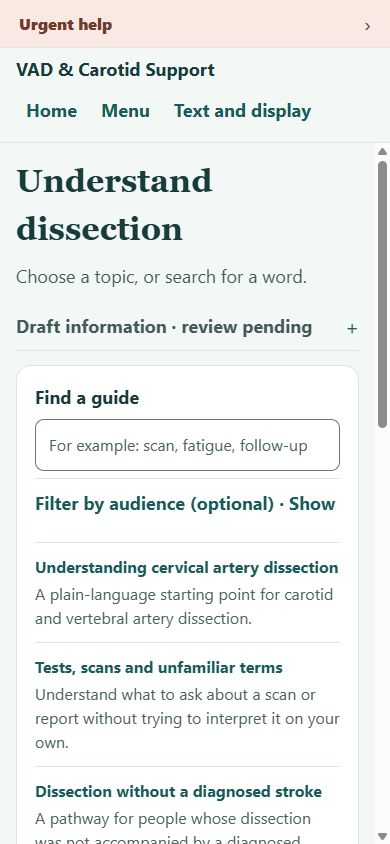
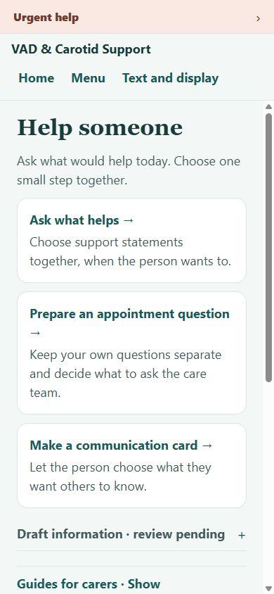
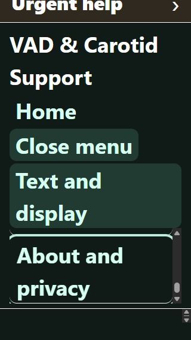
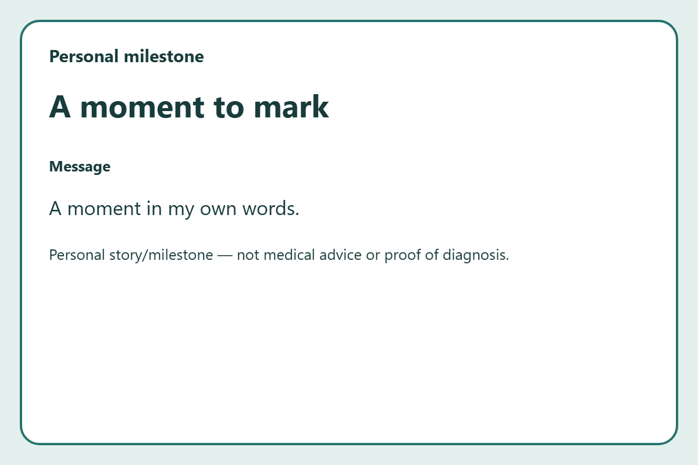

# Patient-menu audit repairs

Engineering walkthrough: 13 October 2026. Before revision: `8ce542e`. The accompanying source revision repairs the ten findings in [the original browser audit](patient-menu-audit-2026-10-13/index.html). This is a developer walkthrough using synthetic data, not a patient study, clinical approval or accessibility conformance declaration.

My experience rating is **5/10 before and about 7/10 after**. Lost drafts and unreachable controls were the largest barriers. The revised site gives useful actions sooner and asks the person to remember less. Real patient/carer and assistive-technology testing can change this assessment.

| Finding | Repair | Evidence |
|---|---|---|
| F1: enlarged menu cannot scroll | Measured header position/content and bounded independent scrolling; full-sized links and Escape focus return retained | Pointer and keyboard reached the final link at 390px; doubled app text at 320 × 568 and 844 × 390 also kept it reachable |
| F2: sheet drafts disappear | Separate memory-only sheet sessions retain notes and choices; only Save persists; generic hub shows unsaved drafts | Both sheets survived Home → Saved → return; explicit saves restored after reload; pending-write/clear, failed save and deletion tests |
| F3: simplified-reading dead end | A single effective mode drives checkbox, content and pagination, with an explicit local override | Global simplified on + local pace off shows all content; global/local model combinations tested |
| F4: useful content buried | Short headings and expandable review detail; optional viewing controls; guides/search/choices appear earlier | Three guide choices visible in the initial 390px library view; recovery text and support choices visible without initial setup panels |
| F5: reading/search reset | Section, pace, search and audience retained in app-session memory | Section 2 and fatigue search restored after leaving and returning; clear-all resets reading/search |
| F6: carers get another reading list | Support, appointment and communication-card actions first; guides optional underneath | Carer route walkthrough and screenshot |
| F7: wrong radio state | Removed duplicate guide text-size radios; use the existing global text controls | Checkbox exposes checked state, global text controls expose pressed state, and keyboard Space works |
| F8: glossary dead end | No-results links to the existing tests/terms guide and appointment tool | MRI search → tests guide worked with keyboard Enter; no new clinical definition authored |
| F9: unclear resource trust | “Links shown”, plain source types, explicit clinical-review status and expandable appraisal/rights details | Directory walkthrough; link checking remains distinct from clinical approval |
| F10: typing hides the easy card path | Selectable communication statements first; name and own words optional underneath | Statement → preview → PDF without typing; practical and milestone outputs remained separate |

Read-aloud is near the guide title and starts only on request. One-section reading reads the selected section; changing section/pace or leaving the route stops it. The start/stop interface was exercised, but audible quality and assistive-technology interaction were not assessed.

## Screens and checks

The [browser check log](patient-menu-audit-2026-10-13/after/checks.json) and adjacent sanitized screenshots record the synthetic walkthrough. All nine menu destinations, Home, Text and display, Urgent help and both card routes were visited. Keyboard activation, skip focus, menu Escape, deletion cancellation, saved/unsaved labels, dark/high-contrast settings, enlarged app text and narrow layouts were checked. Actual deletion and clear-all were tested with isolated in-memory adapters; no user data was deleted through the browser.

Three requests during the observed support-note/navigation/save and personal-PDF flow loaded same-origin export code/fonts. Invented markers were absent from captured request data, console output and URLs. This is a limited observation, not proof about every browser, hosting log or device backup. No notes, names or medicines appear in the saved hub.

Validation: locked `npm ci`, TypeScript, **47 unit tests**, content/review/native-config validation, static Expo web export, 32 exported route/shell checks and whitespace checks passed locally. The dependency lockfile and six existing persistent storage keys are unchanged. No dependency was added for these repairs.

## Remaining evidence

- NVDA, VoiceOver, TalkBack, actual browser 200% zoom and physical-phone touch remain untested. Doubled app text is a separate check from browser zoom.
- Patient/carer usefulness sessions and clinical review remain unrecorded. These repairs do not approve the guide text or change the legal/translation release status.
- Native exports and accessibility still need device verification. Downloaded PDFs are not claimed to be tagged accessible PDFs.
- Unsaved edits and reading state last only while the app session remains open; reload/close loses them. Exports, printouts, backups and other browser-profile users remain outside app deletion control.

The app keeps the existing Expo structure and separate Atlas tooling. Three focused lower-cost subagents handled sheet drafts, menu sizing and reading sessions; the primary agent integrated and tested their work. The referenced `C:\Work\.tessl\RULES.md` was absent.
