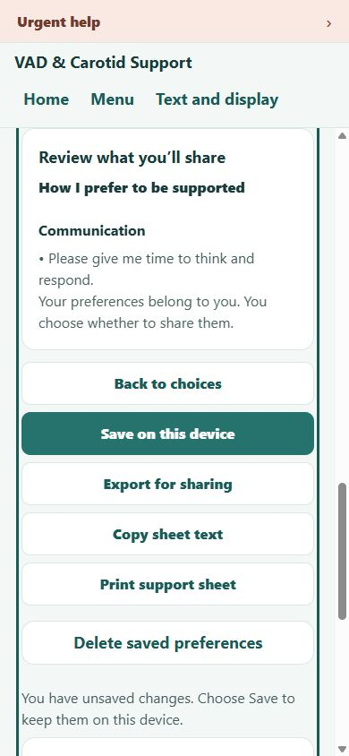

# Follow-up patient/carer UX audit — 13 October 2026

The observed interface scored **7–8/10 before this round's repairs**. Useful features include four clear Home tasks, selectable questions/preferences, separate card previews, truthful saved states and actual local downloads. This round found two interaction faults and two reading/navigation barriers. Focused repairs and fresh retests are below; passing them is not a new whole-product rating.

These are five independent **AI assessments of fresh primary-actuated browser evidence**, not five independent browser runs or patient sessions. T1/T3/T5 are the original returning agents. T2/T4 are fresh gpt-6-luna agents with no inherited conversation or ratings. Each declared priorities before receiving captures. T1's child browser connection failed; the coordinator operated the isolated previews. Impairments, clinical expertise and human completion times are not simulated as evidence.

## Method and individual verdicts

Frozen revision: `8c4087e9fa2764ae3b5cd791c0d5a66834372936`. [Build/origin fingerprint](return-audit/build.json), [action journal](return-audit/interactions.json), [menu coverage](return-audit/menu-coverage.json), [guide coverage](return-audit/guide-coverage.json). The original `localhost:4173` preview and saved information were not used for fixtures. All captured names, notes, medicines and dates are invented. Transient incorrect viewport/paint captures were rejected and replaced.

All reports were checked and locked before application edits. Factual transcription/path mistakes were corrected against raw evidence without changing scores. [SHA-256 locks](return-audit/report-locks.json) preserve accepted reports; retests remain separate. Rubric: 0–2 each for navigation, reading/access, practical usefulness, data/output trust and interruption recovery. Confirmed critical failures would cap a score at 4; none was found in the exercised scope. Earlier scores have different coverage and are not a controlled comparison.

| Perspective | Mode | Score | Main deduction | Verdict |
|---|---|---:|---|---|
| T1: newly diagnosed, without stroke | Returning | 8/10 | Crowded enlarged menu; card Escape inconsistency | [Report](return-audit/T1/report.md) |
| T2: memory/attention difficulty | Fresh assessment | 7/10 | Long path to preview; sheet view/place resets | [Report](return-audit/T2/report.md) |
| T3: low vision/limited hand movement | Returning | 7/10 | Short-height crop; untagged PDFs; Escape | [Report](return-audit/T3/report.md) |
| T4: busy family carer | Fresh assessment | 8/10 | Long preference list before review; Escape | [Report](return-audit/T4/report.md) |
| T5: fluctuating fatigue/light sensitivity | Returning | 7/10 | Supplemental reading density; sheet return; glossary scope | [Report](return-audit/T5/report.md) |

## Numbered journeys and coverage

| Step | Journey | General health and evidence | Limit |
|---|---|---|---|
| 1 | Home and all nine Menu destinations | Four useful tasks; all nine links activated and Menu closed. [Home](return-audit/T1/01-home.jpg), menu record | Shared coordinator coverage, not five discoveries |
| 2 | Guides, sources and glossary | Seven complete rendered DOM samples have sources/review limits; artery search matches; MRA empty result gives guide/question links. [Library](return-audit/T1/02-guides.jpg), [empty search](return-audit/T1/04-glossary-empty.jpg) | DOM samples do not establish comprehension or clinical accuracy |
| 3 | Guide reading, display change and return | Recovery section 2 resumed after dark/roomier settings and Back; all five sections traversed. [Return](return-audit/T5/02-dark-resume.jpg), reading record | Full-reload reading position not tested |
| 4 | Appointment select/note/preview/save/export/delete | Unsaved content returned in-app; explicit save restored after reload; actual text download; Escape cancel and confirmed delete worked. T2 captures/[delete record](return-audit/T2/delete-check.json) | Locator auto-scroll does not prove easy discovery |
| 5 | Support select/note/review/save/export/delete | Same content preservation and explicit output; long list delayed review. [Support](return-audit/T4/02-support-saved.jpg), T4 return/export/delete records | Individual checkbox deselection not isolated this round |
| 6 | Practical card form/preview/edit/saved return/download | Optional blank fields; selected statement; PDF/text match preview and omit hidden date. [Preview](return-audit/T4/04-card-preview.jpg), [output checks](return-audit/T4/output-checks.json) | Opening Edit tested; changing an already-saved value not isolated |
| 7 | Milestone form/preview/download/restore/delete | Neutral wording; actual PNG/PDF/text; hidden date and medical fields excluded; deletion kept practical card. [PNG](return-audit/T4/milestone.png), T4 records | OS print/share cancellation not tested |
| 8 | Display, keyboard, narrow and short layouts | 390px, 320px and 844×320; doubled app text/high contrast; nine links reached by Tab; skip moved focus to main. T3 shots/[bounds](return-audit/T3/keyboard-menu.json) | App text doubling is not browser zoom or NVDA |
| 9 | Urgent help, legacy routes, unavailable page/history/reload | Persistent link; legacy routes loaded; 404 returned Home; Back/Forward/reload worked. [Urgent](return-audit/T1/05-urgent.jpg), T1 legacy/T3 navigation records | Emergency wording not approved by this UX review |
| 10 | Local privacy, generic saved labels and clearing | Saved list concealed fields; 12 scoped card requests/logs had no synthetic markers; one populated practical card cleared after cancel/reload. [Clear proof](return-audit/clear-all.json), T4 privacy/output records | Other categories already absent in this UI clear test; all-key deletion separately unit-tested |

Read-aloud requested/stopped states were observed, with no audible-output claim. True browser zoom, screen readers, OS print behavior, native devices, multiple real profiles and malformed browser storage were not exercised. Long/Unicode/malformed values, all six keys, failed storage and clear/write races have separate unit evidence. This round did not independently repeat every tester's original full checklist; every omitted area is a limitation rather than a pass.

## Findings, repairs and retests

| Finding | Classification / before evidence | Accepted repair | Fresh retest |
|---|---|---|---|
| Appointment one-section mode and place reset after Home/return | Confirmed fault; [trace](return-audit/T2/view-interruption.json); support used the same local-state pattern | Separate session-only sheet view records retain section, mode, filter and open options. Global Simplified reading supplies the default | [Appointment return](return-audit/retest/02-appointment-resume.txt), support return; new independent-state/clear regression tests |
| Escape leaves card deletion open | Confirmed inconsistency; visible Cancel worked. [Before](return-audit/T4/card-deletion.json) | Cards share the sheet confirmation: Cancel focus, Escape, returned focus and success-only closing. Failed removal returns false and retains Cancel/retry | [After](return-audit/retest/card-escape-check.json), practical Escape transcript, confirmed milestone delete/reload |
| Review/export below long lists and notices | Usability barrier identified by T2/T4 | Review your sheet appears when content exists, scrolls/focuses preview without saving/exporting. Back to choices returns focus; large-text summary rows wrap | [Appointment](return-audit/retest/01-appointment-review.jpg), [support](return-audit/retest/03-support-review.jpg), 320px/doubled-text preview |
| Focused skip link crops urgent row in short landscape | Visual barrier; essential links remained reachable. [Before](return-audit/T3/04-landscape-double.jpg) | Menu reserves enough room for the skip target and outline | [After](return-audit/retest/05-landscape-menu.jpg): urgent top=0, window scroll=0; all nine links still reached at 320px |

The [repaired-build fingerprint](return-audit/retest-build.json) and [action/geometry journal](return-audit/retest/interactions.json) identify the working-tree build. Separate affected-assessor retests are recorded for [T2](return-audit/T2/retest.md), [T3](return-audit/T3/retest.md) and [T4](return-audit/T4/retest.md); these remain assisted reviews, not newly independent browser runs. Follow-up captures close the initial Back-button evidence gap: keyboard activation focuses [Appointment choices](return-audit/retest/08-back-to-choices.txt) and [Support choices](return-audit/retest/09-support-back.txt). The [global setting capture](return-audit/retest/global-simplified-setting.txt) shows Simplified reading enabled, with one-section defaults observed on both sheet routes. Native focus and true browser zoom remain untested.

## Disagreements and gaps

T1 valued source transparency; T5 found supplemental reading costly. Keep sources while considering shorter expandable material after real feedback. T4 valued printable cards; T3 identified untagged PDFs. HTML/text alternatives remain necessary. T4/T5 wanted more glossary coverage; the MRA fallback works, and new medical definitions need separate review. None was invented.

Enlarged menus still require vertical scrolling. Off-screen preceding items are distinct from an inaccessible focused action; all nine focused link bounds were checked. The remaining nested-scroll preference needs real-user testing. Full reload intentionally loses session-only reading place and unsaved edits; explicit Save retains sheet/card contents. No automatic save was introduced.

## Validation and delivery

**65 unit tests**, content/review/native configuration checks, TypeScript, static web export and validation of **32 artifacts / 27 routes** passed. New tests cover independent sheet views, interruption, global-mode override, exclusion of private fields and successful/failed clearing. Browser retests cover preview focus/return, simplified defaults, retained views, saved reload/export, both card Escape flows, milestone deletion and enlarged narrow/landscape menus.

Existing licences, six keys, v1 saved-data compatibility, separate card models and teal/rounded design remain. No dependency, account, analytics, backend, automatic export or clinical wording was added. [Mobile adaptation](MOBILE_DESIGN_PATTERNS.md) explains the shared Expo patterns. Real patient/carer sessions, NVDA, true zoom, native VoiceOver/TalkBack and clinical approval remain separate.

